<picture>
  <source srcset="docs/assets/graphics/hero-banner.svg" type="image/svg+xml">
  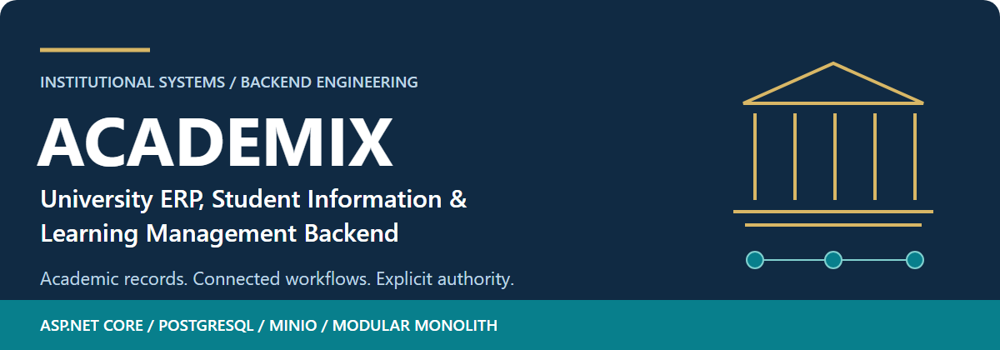
</picture>

# ACADEMIX

**University ERP, Student Information & Learning Management Backend**

ACADEMIX connects admissions, teaching, assessment, academic records and institutional operations in one ASP.NET Core API. Its engineering focus is the integrity of decisions across those domains: who may act, which evidence is current, what must commit together, and what happens when a dependency fails.


**Backend only.** No student/admin frontend or hosted university deployment is included. The accepted release is **APPROVED_WITH_DOCUMENTED_LIMITATIONS**, supported by a dated **696/696 passing** verification run. Portfolio acceptance is distinct from production deployment certification.

[Capabilities](#core-capabilities) · [Workflows](#connected-business-workflows) · [Architecture](#architecture) · [Evidence](#verified-engineering-evidence) · [Quick start](#quick-start--docker) · [Documentation](#documentation-index)

## Why ACADEMIX exists

A grade correction can affect a transcript, degree eligibility, graduation approval and an already issued document. A financial hold can affect registration. A room reservation must respect teaching and examination commitments. Treating each university function as an isolated endpoint leaves those dependencies unresolved.

ACADEMIX models the connections explicitly. Published evidence, current academic state and historical artifacts have different lifecycles; authorization follows the institution and the resource; financial and academic mutations use relational transactions and concurrency controls where required.

## At a glance

| Area | Implemented approach |
|---|---|
| Architecture | Modular monolith; one API project and one test project |
| Persistence | PostgreSQL 18, EF Core 10, 39 applied migrations in the accepted run |
| Identity | ASP.NET Core Identity, JWT access tokens, rotating refresh sessions |
| Institutional access | Roles plus service-level membership, assignment and resource checks |
| Storage and delivery | Private MinIO objects, transactional Outbox, persisted retry/cleanup work |
| Verified snapshot | 540 local + 155 PostgreSQL + 1 real MinIO orchestration = 696 passes |
| API discovery | Development-only OpenAPI JSON at `/openapi/v1.json` |

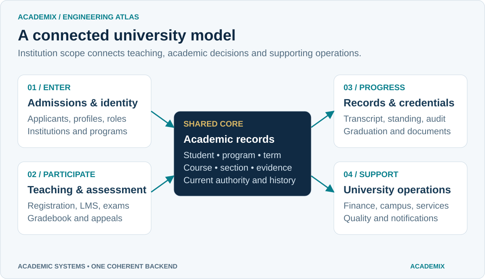

## Core capabilities

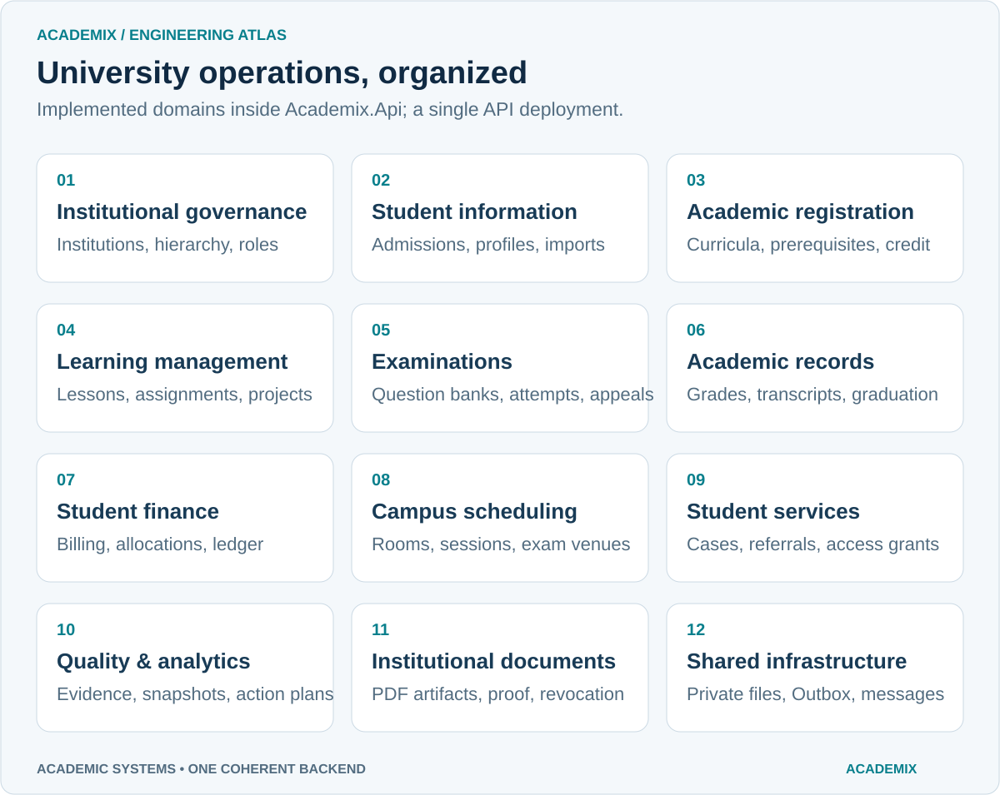

**Governance and student information.** Platform and institution administrators manage institutional hierarchy and scoped access. Admissions, applicant onboarding, profiles and institutional imports connect a student to the academic structure.

**Curriculum and registration.** Programs, terms, sections, prerequisites, curriculum plans, approved recognition and exceptions support controlled enrollment. Program transitions retain recognition history while eligibility checks trace qualifying source credit.

**Learning and assessment.** Instructors and teaching assistants deliver units, lessons, announcements and assignments. Private submissions, group projects, rubrics and discussions connect to question banks, published examinations, frozen attempts, grading and appeals. Permissions depend on the actual teaching assignment and operation.

**Records and completion.** Official gradebooks, manual overrides, transcript synchronization, standing, advising and degree audits feed separate graduation review and credential decisions. Institutional documents support PDF artifacts, verification proofs, revocation, supersession and source-dependent validity.

**Finance and campus operations.** Institution administrators manage fees, invoices, scholarship assistance, verified payment records, allocations, refunds, correcting journals and policy-controlled holds. Campus workflows cover facilities, room capacity, weekly timetable slots, dated sessions and physical examination venues with collision checks.

**Services, communication and quality.** Students and authorized staff use service cases, private comments, attachments, referrals and active queue grants. Private messaging, in-app notifications and scheduled announcements support communication. Quality workflows distinguish proxy evidence from direct team criterion observations, retain published snapshots and sealed evidence packs, and track follow-up actions and trends.

## Real API captures

The configured interface is **machine-readable OpenAPI JSON**, displayed below in the browser's native JSON view. These genuine captures came from the current Release assembly running against a newly created, isolated local PostgreSQL database. They show contract discovery, not Swagger UI, a frontend or execution of every listed workflow.

| OpenAPI identity and first operation | Academic workspace response schema |
|---|---|
| [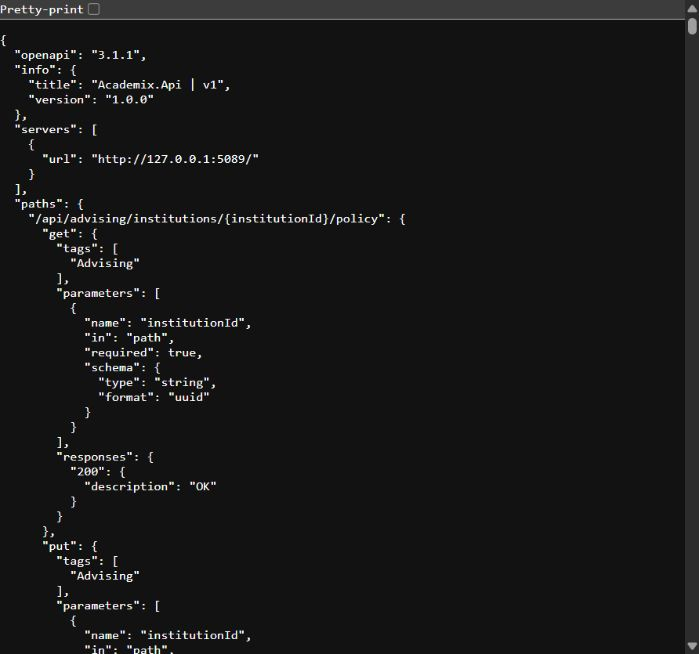](docs/assets/screenshots/openapi-overview.jpg) | [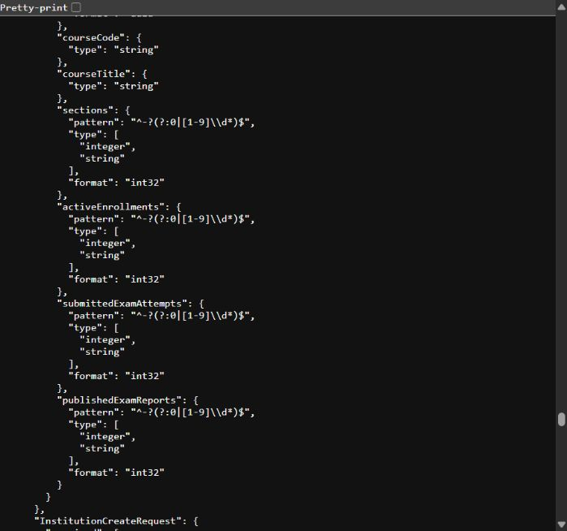](docs/assets/screenshots/academic-schema.jpg) |

Open either image for full size. [Capture provenance and scope](docs/API_GUIDE.md#screenshot-provenance) explain the isolated environment and sanitization.

## Connected business workflows

### Admission to graduation

Admission and program membership establish the registration context. Prerequisites and curriculum rules constrain enrollment; learning activities and examinations generate assessment evidence. Official grades then feed synchronized transcripts, recalculated standing and qualifying degree credits. Graduation review and credential issuance remain authorized decisions rather than automatic consequences of a passing score.

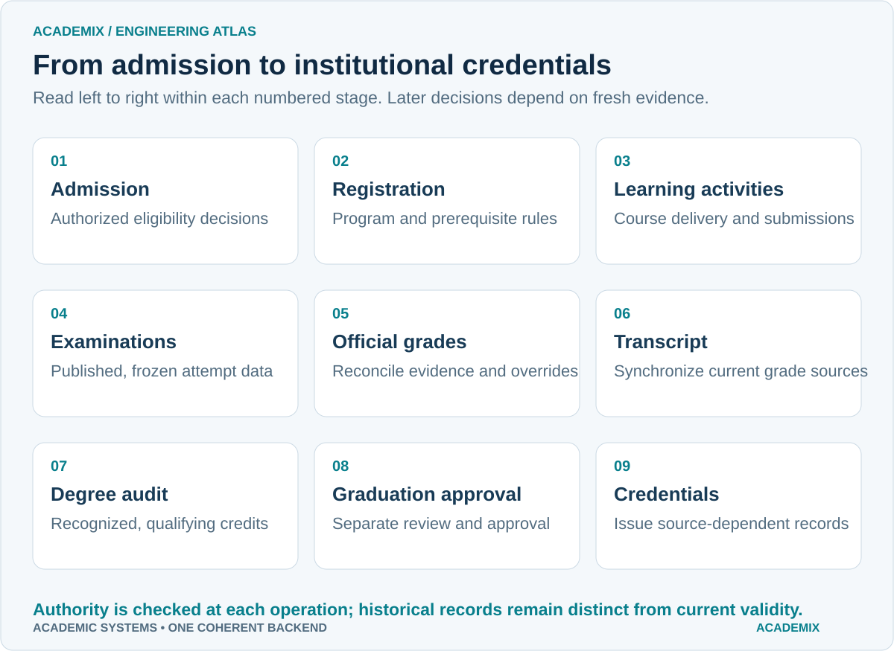

### Corrections and academic freshness

A corrected assessment does not silently replace an official grade. Reconciliation makes the source change explicit. Current transcript reads require fresh sources; standing must be recalculated after relevant transcript changes. Recognition checks follow local source credit through program transitions and require a current qualifying pass; legitimate approved external credit retains its own provenance.

Historical document bytes remain retrievable while public verification can report a changed academic source. Reassessment and reissuance preserve that distinction.

<details>
<summary>View the assessment-to-records reconciliation diagram</summary>

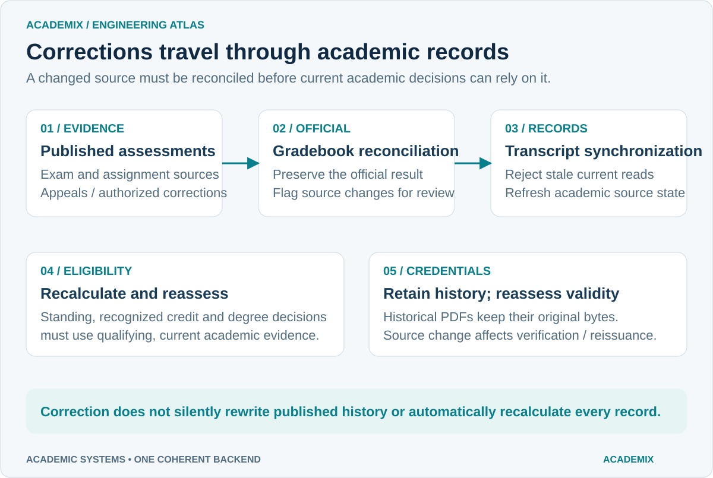

</details>

### Billing and financial integrity

Fees and invoices establish obligations; scholarship assistance and verified payment allocations reduce them through controlled operations. Balanced journal entries and correcting entries preserve accounting evidence. Holds and clearances connect finance to academic actions under explicit policies. Currency amounts remain separated. Recorded payment/refund workflows do not perform bank settlement or card processing.

<details>
<summary>View the student finance lifecycle</summary>

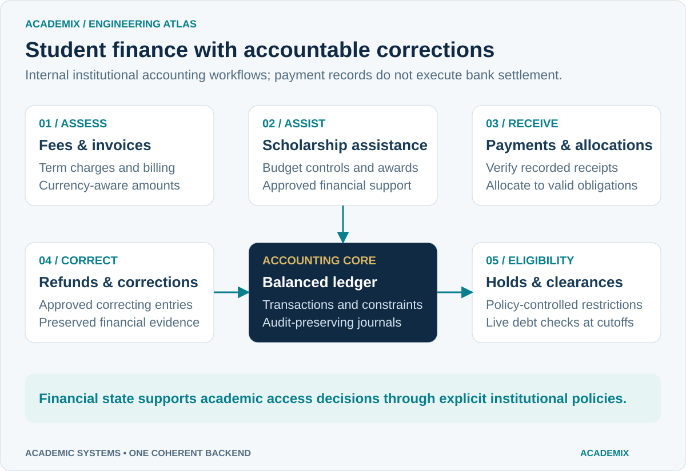

</details>

### Scheduling and institutional services

Teaching sessions and physical examination reservations share room capacity and collision constraints. Administrative occupancy/calendar access is distinct from supported member availability queries. Service requests use queue grants and object access checks to control who may read a case, comment privately, attach evidence or refer it onward; a broad staff role alone does not confer every case's access.

## Architecture

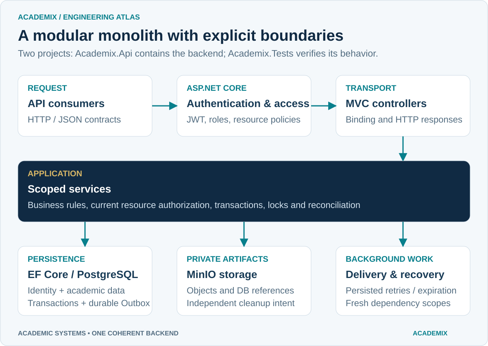

`Academix.Api` is one deployable application. Controllers handle transport; scoped services implement workflows, resource authorization and transaction orchestration. EF Core and ASP.NET Core Identity share `AcademixDbContext`. PostgreSQL holds relational state and durable Outbox records; MinIO holds private artifacts. Background workers perform delivery, expiration and recovery work.

This structure keeps cross-domain academic and finance operations close to their relational transaction boundary while keeping HTTP handling separate from business rules. It uses no message broker, microservice deployment topology or independent application-layer assemblies. See the [architecture guide](docs/architecture.md) for the repository's structural notes; early phase examples there are historical subsets of the current domain coverage.

## Roles, authorization and institution isolation

The implemented roles are `SuperAdministrator`, `InstitutionAdministrator`, `Instructor`, `TeachingAssistant` and `Student`. Role checks are supplemented by active-account, institution membership, teaching assignment, enrollment, ownership and workflow-specific policies. Global administration is an explicit privileged path.

Tenant scope is enforced by the relevant service operations; it should not be inferred from a client-supplied institution ID or assumed to come from a universal EF tenant filter. Sensitive mutations that wait on locks revalidate current authority after acquisition. PostgreSQL regressions exercise account disablement, role removal and membership changes during those waits.

<details>
<summary>View identity and institution access boundaries</summary>

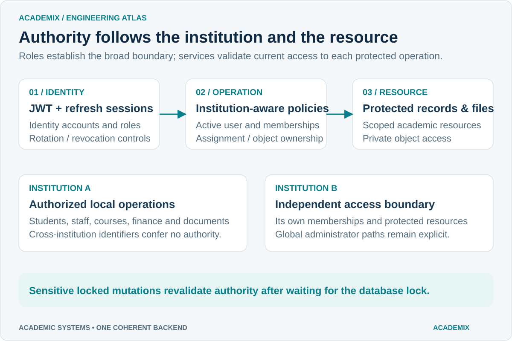

</details>

## Database and data integrity

The accepted suite applied all **39 EF Core migrations** to PostgreSQL 18 and verified fresh and populated upgrade paths. Relational constraints, scoped transactions, version checks and operation-specific locking protect the tested mutation paths. Published academic and quality evidence retains historical meaning; correcting actions and reconciliation expose changes rather than rewriting that evidence invisibly.

Institutional documents use **HMAC-based verification proofs** with managed key lifecycle and stored-artifact integrity checks. They are not qualified certificate signatures. Database, object-store and protected Data Protection keyring backups must be considered together.

## Reliability and private storage

The transactional Outbox records delivery intent with the business change. Workers lease persisted work, retry with backoff and create fresh dependency scopes for retried EF operations. Stable deduplication keys are used where implemented; this is not a universal exactly-once guarantee.

Object upload and relational commit are separate boundaries. Cleanup intent is committed independently before upload; recovery checks current database references under institution coordination before removing an orphan. The real MinIO orchestration exercised authorization, rollback after upload, outage/restart recovery, referenced-object preservation and cleanup. Independent client retries can still create distinct artifacts.

<details>
<summary>View transaction, Outbox and storage recovery boundaries</summary>

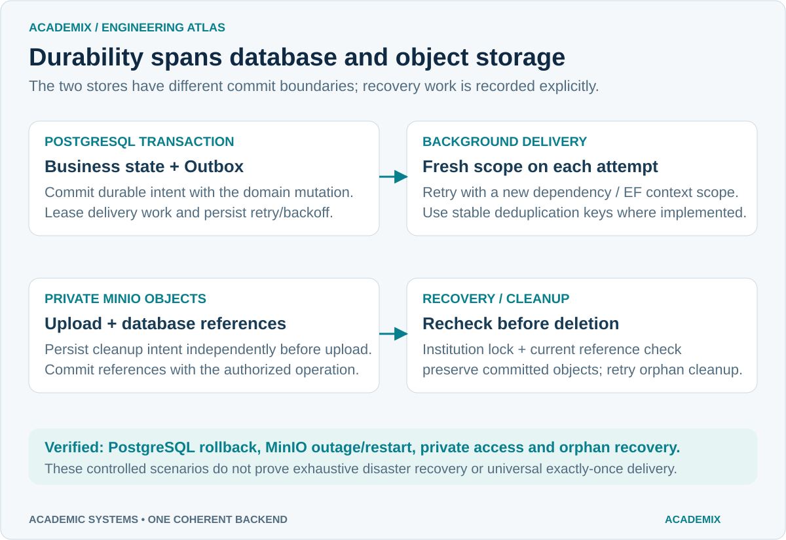

</details>

## Verified engineering evidence

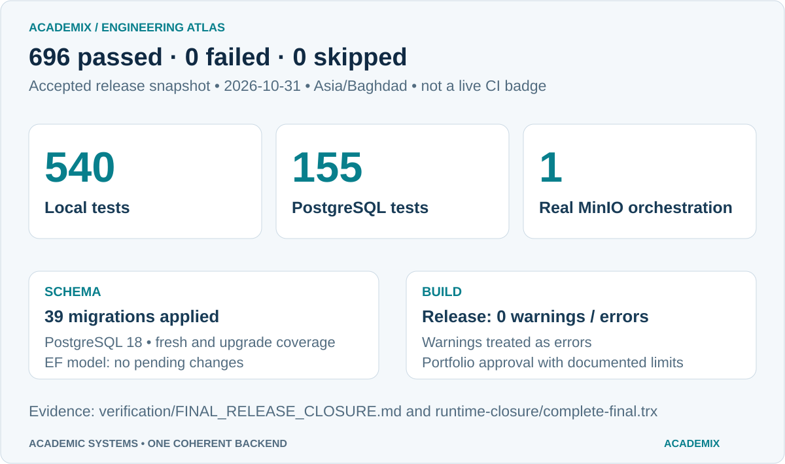

**Executed release snapshot: 2026-10-31, Asia/Baghdad.** Counts below come from the same final complete run; focused reruns are not added to the total.

| Gate | Actual accepted outcome |
|---|---|
| Complete unfiltered suite | **696 passed / 0 failed / 0 skipped** |
| Docker-independent cases | 540 passed |
| PostgreSQL integration scenarios | 155 passed |
| Real MinIO orchestration | 1 passed; multiple storage/document recovery subchecks |
| Schema | 39 applied migrations; fresh and populated upgrade coverage |
| EF model consistency | No pending model changes |
| Release build | 0 warnings / 0 errors; warnings treated as errors |

Read the [final release closure](verification/FINAL_RELEASE_CLOSURE.md), [complete TRX](verification/runtime-closure/complete-final.trx) and [machine-readable results](verification/runtime-closure/final-results.json). Earlier failures and their resolved fixture prerequisites remain documented in the closure. This presentation change did not rerun the suite or replace those historical results. The image is a dated evidence summary, not a live CI status badge.

## Technology stack

| Concern | Technology in this snapshot |
|---|---|
| Runtime / HTTP | .NET 10; ASP.NET Core 10.0.3; SDK 10.0.103 in the accepted run |
| Relational persistence | EF Core 10.0.3; Npgsql EF provider 10.0.0; PostgreSQL 18 |
| Identity / access | ASP.NET Core Identity; JWT bearer; refresh sessions; service policies |
| Private artifacts | MinIO; Minio .NET SDK 6.0.5 |
| PDF generation | QuestPDF 2026.9.1; deployment-appropriate license selection required |
| API discovery | Microsoft.AspNetCore.OpenApi 10.0.3; Development JSON document |
| Verification | xUnit 2.9.3; ASP.NET Core test host; Testcontainers.PostgreSql 4.16.0 |
| Local infrastructure | Docker Linux Engine; Docker Compose |

## Repository structure

```text
Academix.slnx
Academix.Api/
  Controllers/          HTTP contracts and endpoint boundaries
  Services/             Coherent domain workflows and infrastructure services
  DTOs/                 Request and response contracts
  Entities/             Academic, identity and institutional persistence models
  Data/                 AcademixDbContext, configurations and Migrations/
  Storage/              Private MinIO file access
  Extensions/           Dependency registration and application pipeline
  Middleware/           Shared HTTP behavior
  Dockerfile
Academix.Tests/
  Integration/          PostgreSQL and real-provider regression scenarios
  ...                   Local domain, authorization and security cases
compose.yaml            PostgreSQL, MinIO and API local environment
docs/                   Guides, original visuals and genuine API captures
verification/           Historical audit and final executed release evidence
```

## Quick start — Docker

Prerequisites: Docker Desktop with its **Linux Engine** running and Docker Compose. Run these PowerShell commands from the repository root:

```powershell
docker info
Copy-Item .env.example .env
# Edit .env privately before starting. Generate a fresh value for each secret:
[Convert]::ToHexString([Security.Cryptography.RandomNumberGenerator]::GetBytes(32))
```

Replace every `CHANGE_ME`: `POSTGRES_PASSWORD`, `JWT_SIGNING_KEY`, `MINIO_ROOT_USER` and `MINIO_ROOT_PASSWORD`. The signing key must contain at least 32 UTF-8 bytes. Choose a MinIO root username and a separate strong password. Set `DOCUMENTS_PDF_LICENSE` to the valid QuestPDF category appropriate to your usage before exercising PDF operations; the test suite's Evaluation setting is not a production license grant.

For an administrator on a **fresh local database**, set `BOOTSTRAP_ENABLED=true` and supply `BOOTSTRAP_EMAIL` and `BOOTSTRAP_PASSWORD` privately. The password requires at least 12 characters with uppercase, lowercase, a digit and a symbol. Bootstrap runs through the startup migration path. No populated demo university or ready-made credentials are supplied.

```powershell
docker compose up -d --build
docker compose ps
Invoke-WebRequest http://localhost:8081/health/ready
# Development OpenAPI contract:
Start-Process http://localhost:8081/openapi/v1.json
```

Compose applies configured migrations at API startup. Readiness probes PostgreSQL; it does not certify MinIO health. The API maps host **8081** to container **8080**; PostgreSQL is loopback **5434**; the MinIO console is loopback **9001**. MinIO's object API **9000** is internal to the Compose network by default. Services use Compose DNS internally.

After first provisioning, disable bootstrap, clear its email/password in `.env`, and recreate only the API:

```powershell
docker compose up -d --force-recreate api
# Stop the environment while retaining database, object and keyring volumes:
docker compose stop
```

Keep `.env` private. Existing named volumes preserve their initialized credentials and data; changing `.env` does not reset their contents. Local Development/HTTP defaults are for local evaluation. See [development and configuration](docs/DEVELOPMENT.md) for host execution and operational details.

## Local development

Install the .NET 10 SDK. Use a dedicated local PostgreSQL database and a reachable MinIO object API. The [host development guide](docs/DEVELOPMENT.md#run-the-api-on-the-host) includes a loopback-only Compose override, explicit process environment variables, migration commands and bootstrap details. ASP.NET Core host execution does **not** automatically read the Compose `.env` file.

```powershell
dotnet restore Academix.slnx
dotnet build Academix.slnx -c Release --no-restore -warnaserror
# After configuring the process environment as described in the guide:
dotnet run --project Academix.Api --configuration Release --no-launch-profile
```

## Running tests

Run from the repository root after restore/build. The following filters reflect the current test namespaces:

```powershell
# Local cases; no Docker required:
dotnet test Academix.Tests/Academix.Tests.csproj -c Release --no-build --no-restore --filter 'FullyQualifiedName!~Academix.Tests.Integration'
# PostgreSQL scenarios and real MinIO orchestration; Docker Linux Engine required:
dotnet test Academix.Tests/Academix.Tests.csproj -c Release --no-build --no-restore --filter 'FullyQualifiedName~Academix.Tests.Integration'
# Complete current suite:
dotnet test Academix.Tests/Academix.Tests.csproj -c Release --no-build --no-restore
# With the matching EF CLI installed:
dotnet ef migrations has-pending-model-changes --project Academix.Api --configuration Release --no-build
```

Integration tests create isolated infrastructure through Testcontainers and do not need the Compose API. Runtime/source changes can change counts; **696 is the accepted snapshot**, not a guaranteed future discovery count.

## API documentation

In Development, request `/openapi/v1.json`. Compose exposes it at `http://localhost:8081/openapi/v1.json`; the host guide deliberately chooses `http://127.0.0.1:5080/openapi/v1.json`. No Swagger UI is configured. You can import the document into a compatible client; raw schema response descriptions should not be treated as a complete authorization/error contract.

Verified public routes include `GET /api/courses`, `GET /health/live` and `GET /health/ready`. Protected academic operations require a valid authenticated identity and applicable access. See [API discovery, route examples and captures](docs/API_GUIDE.md).

## Documentation index

- [Development and configuration](docs/DEVELOPMENT.md) — Compose, host execution, EF CLI, storage and keyrings.
- [API guide](docs/API_GUIDE.md) — genuine captures, discovery and representative routes.
- [Visual atlas](docs/VISUAL_ATLAS.md) — all diagrams at full width, PNG fallbacks and regeneration.
- [Final release closure](verification/FINAL_RELEASE_CLOSURE.md) — authoritative accepted outcome and limitations.
- [Executed final results](verification/runtime-closure/final-results.json) — test classification and migration outcomes.
- [Architecture notes](docs/architecture.md) — structural background; early phase subsets remain historical.
- [Presentation report](docs/PORTFOLIO_PRESENTATION_REPORT.md) — documentation scope and validation.

Phase design files, roadmap and older audit packages are development history. Their phase-specific descriptions and older test totals do not supersede the final closure.

## Known limitations

- Backend only, with no complete frontend, claimed live university adoption or general production-readiness certification.
- No institutional-scale load/soak benchmark, real institutional-data upgrade or exhaustive crash/ambiguous-commit proof.
- Coordinated database/object/keyring disaster recovery remains an operational responsibility; controlled outage tests are narrower.
- Independent client upload retries may create separate artifacts; no client deduplication token is promised.
- Production TLS, secrets, permissions, backups and infrastructure image pinning require deployment-specific review. Local Compose uses Development/HTTP and mutable image tags.
- Document proofs are HMAC based, financial workflows do not execute banking, and quality packs do not establish external accreditation. Team criterion observations do not establish individual mastery.

## Portfolio engineering highlights

Useful review and interview topics are the **post-lock reauthorization** regressions, **qualifying credit provenance across program transitions**, **freshness checks after grade correction**, **balanced financial corrections**, **persisted Outbox retries with fresh EF scopes**, and **MinIO/database cleanup recovery without deleting referenced artifacts**. Each has concrete source and regression evidence rather than a diagram-only implementation claim.

## Author and license

This release snapshot does not declare verified author metadata or include a root `LICENSE` file. No license is inferred from the portfolio presentation or the design references.

