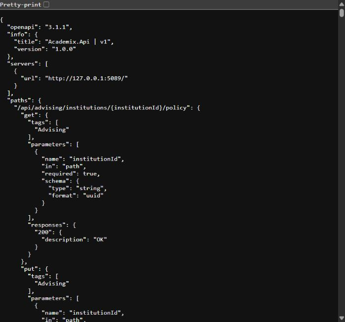
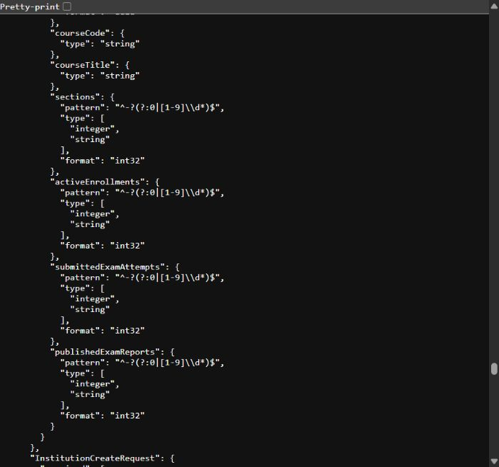

# API discovery and genuine captures

[Back to README](../README.md#api-documentation)

## Available interface

ACADEMIX registers ASP.NET Core `MapOpenApi()` only in Development. Its document is `/openapi/v1.json`. There is no configured Swagger UI, Scalar interface or student/admin frontend. The browser screenshots below show the actual JSON document using native browser rendering. A compatible API client may import it independently.

| Execution mode | URL |
|---|---|
| Repository Compose | `http://localhost:8081/openapi/v1.json` |
| Explicit host guide configuration | `http://127.0.0.1:5080/openapi/v1.json` |
| Isolated capture session only | `http://127.0.0.1:5089/openapi/v1.json` |

The capture port is not a new default. Production does not expose this Development route through the configured mapping. OpenAPI schema descriptions are generated contract metadata; listed response codes do not exhaust authorization or business error behavior.

## Representative verified routes

| Method and route | Meaning |
|---|---|
| `GET /health/live` | Process liveness; no dependency checks |
| `GET /health/ready` | PostgreSQL readiness; no MinIO health check |
| `GET /api/courses` | Anonymous active course catalog |
| `POST /api/auth/login` | Credential-based authentication; keep actual credentials/tokens private |
| `POST /api/auth/refresh` | Refresh-session workflow |
| `POST /api/auth/logout` | Session revocation workflow |
| `GET /api/auth/me` | Current authenticated identity |
| `GET /api/curriculum/students/{studentId}/degree-audit` | Protected student curriculum audit |
| `POST /api/records/sections/{sectionId}/transcript/sync` | Protected transcript synchronization |
| `GET /api/records/students/{studentId}/transcript` | Protected current transcript; freshness rules apply |

Routes were checked against current controllers and the live generated OpenAPI document. The capture session executed discovery and readiness only; this table does not claim every listed business operation was invoked during documentation work. The accepted integration suite provides workflow execution evidence separately.

```powershell
# After starting the documented Compose environment:
Invoke-WebRequest http://localhost:8081/health/live
Invoke-WebRequest http://localhost:8081/health/ready
Invoke-RestMethod http://localhost:8081/api/courses
# Save a fresh contract locally if needed; avoid committing private server URLs:
Invoke-WebRequest http://localhost:8081/openapi/v1.json -OutFile "$env:TEMP/academix-openapi.json"
```

## Screenshot provenance

Captured on **2026-10-31** from the current `Academix.Api/bin/Release/net10.0/Academix.Api.dll`, unchanged from the accepted runtime source. The application listened only on loopback port 5089 and used a newly created PostgreSQL 18 database, `academix_docs`, inside the separate container `academix-docs-20261031`. No existing/unknown database or Compose API was used. All 39 migrations applied. Bootstrap and background work were disabled for this read-only discovery session; credentials were random process-local values and were never included in documentation.

The live contract identified itself as **Academix.Api | v1**, OpenAPI **3.1.1**. Its title is retained as generated. The root API-info endpoint has an old phase label, so it was not presented as a current release-status interface. Release status comes from the unchanged [final closure](../verification/FINAL_RELEASE_CLOSURE.md).

The computer-use browser captured the actual response viewport. Both JPEGs contain schema names, types and loopback server URLs only: no Authorization header, token, password, email, student record, connection string, filesystem path or unrelated browser chrome. No screenshot text was generated, relabeled inside the image or composited. The limited viewport is preserved rather than enlarging it artificially. Captions describe exactly the visible contract fragments.

### OpenAPI overview



### Academic workspace schema



The second capture is a scrolled schema excerpt, not a populated dashboard or an endpoint execution result. The gallery cannot provide Swagger endpoint cards or interactive business screens because those interfaces are absent. This is the documented screenshot limitation; original workflow diagrams explain those domains separately.

Sanitized session metadata is in [capture-runtime.json](assets/screenshots/capture-runtime.json). The dedicated API and PostgreSQL container were stopped after capture; the demo container/data were retained, and existing Docker resources were untouched. The presentation run did not start MinIO or repeat the real MinIO tests: their proof remains the accepted release evidence.
