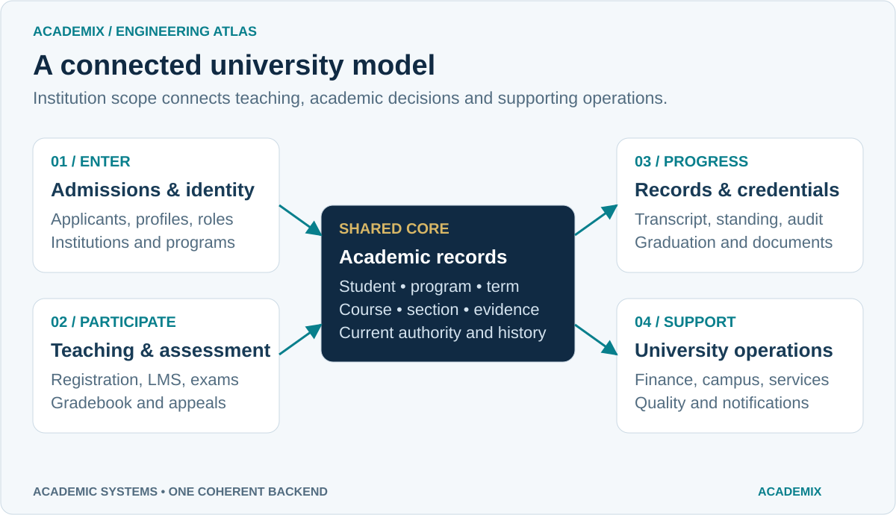
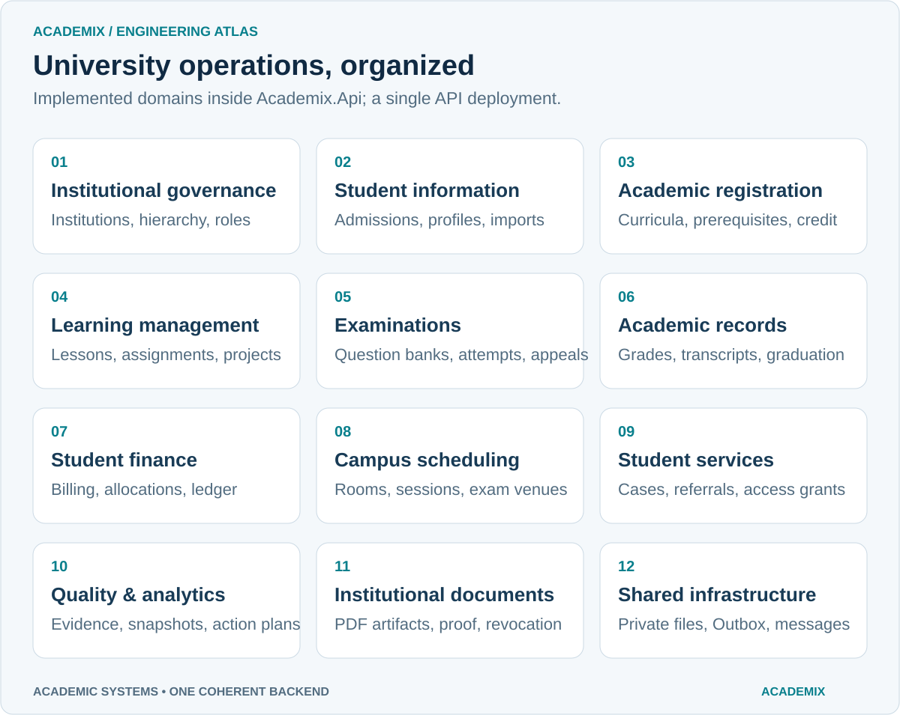
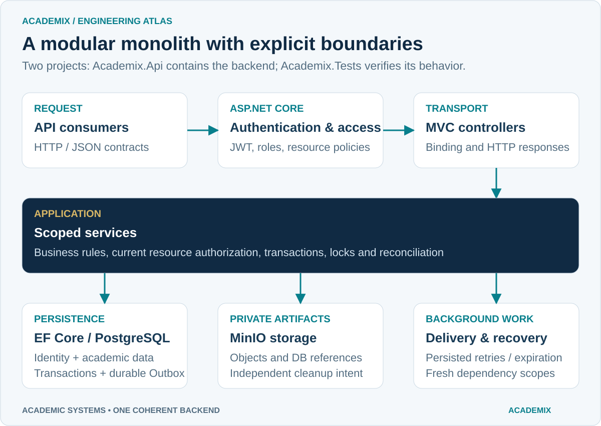
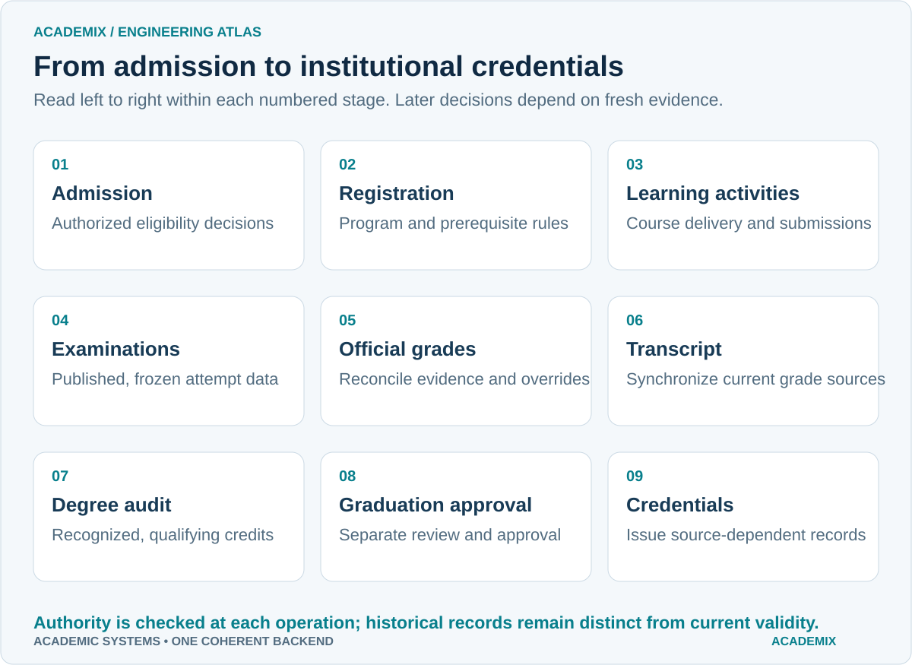
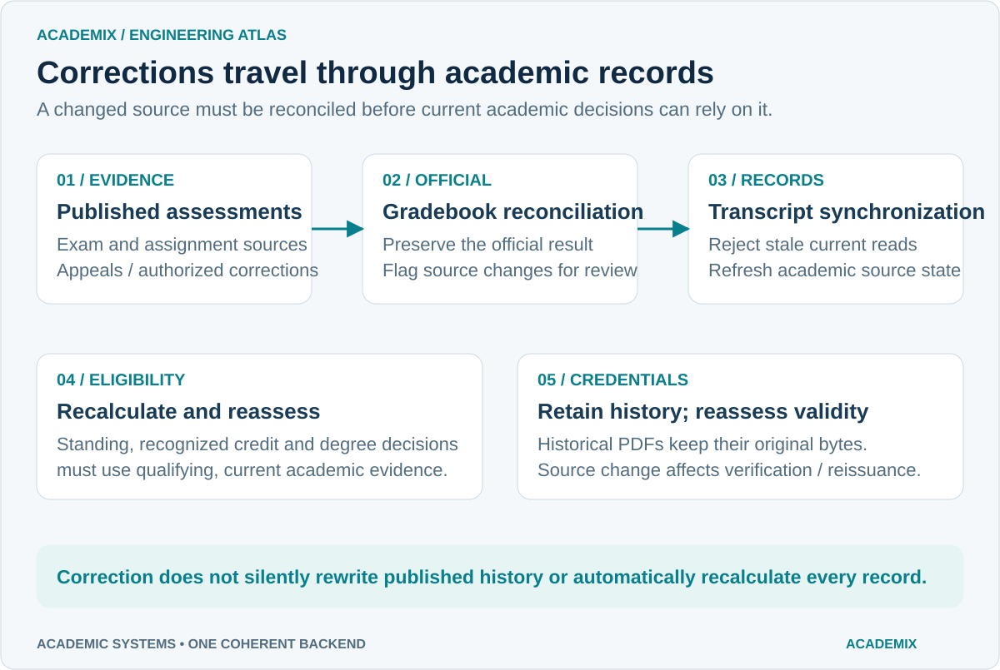
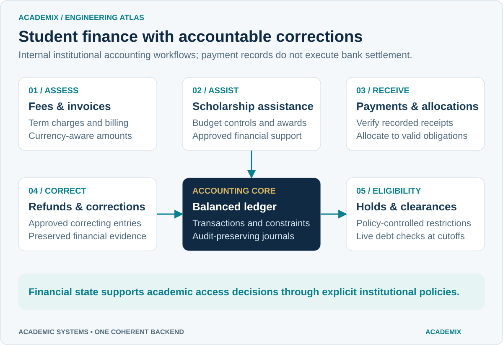
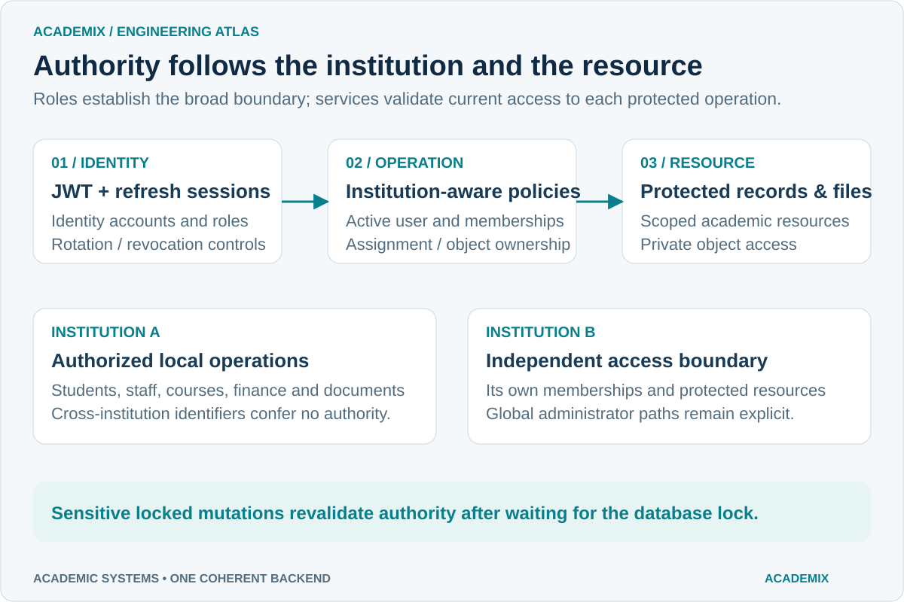
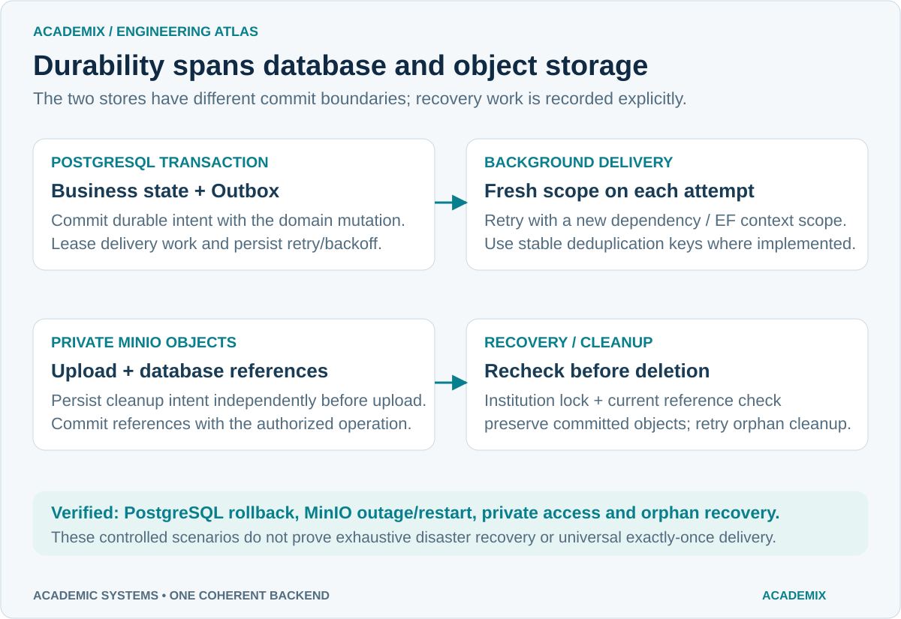
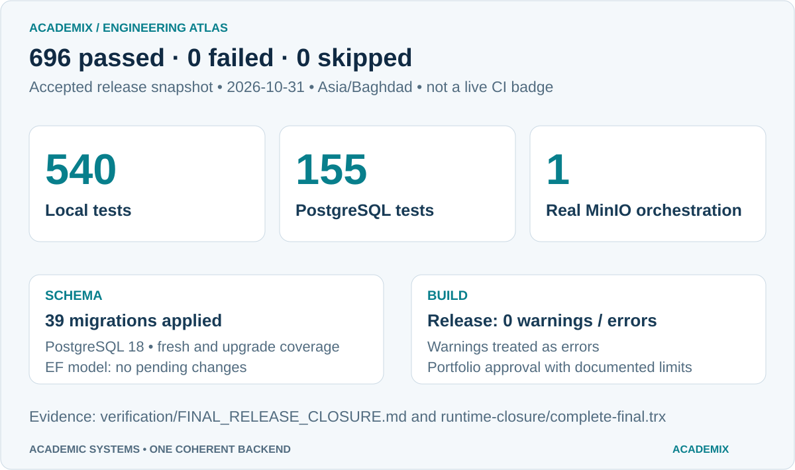

# Visual atlas

[Back to README](../README.md)

ACADEMIX uses an original navy, teal, blue and warm-gold palette with opaque light diagram surfaces. Assets are self-contained SVGs with system-font fallbacks, descriptive titles and no external image/font requests. Matching PNGs provide raster fallbacks. The diagrams describe the implemented backend and the accepted release snapshot; they are not application screenshots.

## Institutional backend identity


[PNG fallback](assets/graphics/hero-banner.png)

## Connected system overview



[PNG fallback](assets/graphics/system-overview.png)

## Implemented business modules



[PNG fallback](assets/graphics/business-modules.png)

## Modular monolith



[PNG fallback](assets/graphics/architecture.png)

## Student academic lifecycle



[PNG fallback](assets/graphics/student-lifecycle.png)

## Examination and grade reconciliation



[PNG fallback](assets/graphics/grade-reconciliation.png)

## Student finance lifecycle



[PNG fallback](assets/graphics/finance-lifecycle.png)

## Security and institution boundaries



[PNG fallback](assets/graphics/security-isolation.png)

## Infrastructure and reliability



[PNG fallback](assets/graphics/infrastructure-reliability.png)

## Accepted verification snapshot



[PNG fallback](assets/graphics/verification-snapshot.png) · [Unchanged release evidence](../verification/FINAL_RELEASE_CLOSURE.md)

## Technology badges


[PNG fallback](assets/graphics/technology-badges.png)

## Regeneration

Run from the repository root with Node.js and PowerShell. The renderer uses the installed Microsoft Edge headless engine and an isolated temporary profile; it changes no application source or configuration.

```powershell
node docs/tools/build-graphics.mjs
./docs/tools/render-graphics.ps1
```

The generator is a documentation utility. Static verification counts intentionally remain tied to the accepted release date; update them only against a newly executed verification report. Review actual renders when changing typography or labels. The [render manifest](assets/graphics/render-manifest.json) records dimensions and PNG sizes. The [presentation report](PORTFOLIO_PRESENTATION_REPORT.md) records final QA and screenshot limitations.
